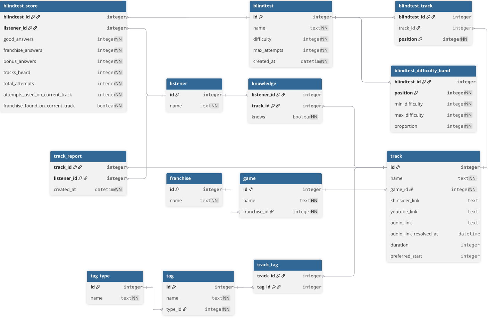

# Music Blindtest

Application pour gérer une base de données de musiques de jeux vidéo et organiser des blindtests.

C'est un projet personnel que je voulais faire depuis longtemps et que je commence enfin sérieusement. Il servira aussi à l'association **InsaLan**, qui pourra l'utiliser pour ses animations.

> Le projet en est encore à ses débuts, la majorité de la roadmap est encore à faire

## Pourquoi ce projet ?

Aujourd'hui, la base de musiques d'InsaLan vit dans un Google Sheet. Ça marche, mais ça devient limité :

- pas de vraies relations entre les jeux, les franchises et les musiques ;
- pas de tags pour filtrer (genre, ambiance, difficulté...) ;
- pas de suivi de qui connaît quelle musique ;
- les liens audio directs disparaissent régulièrement.
- la création de playlists est très compliquée

L'idée est de garder le Google Sheet comme point de départ et de construire une vraie application par-dessus qui finira par s'en détacher.

## Objectifs

- **Une webapp** pour gérer la base et lancer des blindtests.
- **Une version installable** sur Windows et Linux, pour pouvoir héberger l'application en local. Cet aspect-là n'est pas vraiment primordial et est surtout là dans un but d'apprentissage.
- **Importer les données du Google Sheet** (la version modèle à jour du 21/09/26 est disponible dans [`docs/`](docs/ost-insalan-base.csv), la correspondance des colonnes est décrite dans [`docs/import-gsheet.md`](docs/import-gsheet.md)).
- Apprendre différentes techniques au passage (base de données, architecture, packaging, etc.).

## D'où viennent les musiques ?

Les musiques viennent de [KHInsider](https://downloads.khinsider.com/) quand elles sont disponibles. Le problème, c'est que les liens audio directs expirent assez souvent. 

Le projet stocke donc le lien de la page KHInsider de chaque musique et vérifie périodiquement, en tâche de fond, que le lien audio en cache répond encore (`audio_link`, avec sa date `audio_link_resolved_at`). Si besoin seulement, il va rechercher un nouveau lien sur la page KHInsider.

> Si une musique n'est pas sur KHInsider, ou si son lien KHInsider ne marche plus, on utilise son lien YouTube à la place.

Les liens audio du Google Sheet ne sont pas repris à l'import, car aucun n'est fiable : seuls les liens YouTube le sont. `audio_link` est rempli à partir des pages KHInsider, ou pointe vers le serveur pour un audio YouTube téléchargé.

L'audio d'une musique YouTube est téléchargé une fois sur le serveur, dans `backend/data/youtube-audio/` (pas commit, comme la base), puis servi par l'API. Le téléchargeur est un module privé, absent du dépôt : sans lui, le site marche normalement, mais aucun nouvel audio YouTube n'est téléchargé.

## D'où viennent les images ?

Chaque jeu a une image, affichée une fois la réponse donnée dans Discover et dans les blindtests.

Les pochettes sont rangées sur le même serveur que les musiques KHInsider, dans le dossier de chaque album. Le projet les cherche donc là-bas sous les noms habituels (`00 Front.jpg`, `Cover.jpg`, `folder.jpg`...) et garde le résultat de chaque album pour ne pas refaire les mêmes requêtes. Ça marche pour la majorité des albums, mais pas tous.

Pour les autres, il y a deux solutions :

- les joueurs peuvent proposer une image avec le bouton **Proposer une image**, un admin l'accepte ou la refuse dans l'onglet Images de la page admin ;
- un admin peut ouvrir la page de l'album sur KHInsider avec le script [`tools/khinsider-album.user.js`](tools/khinsider-album.user.js) installé dans son navigateur, qui envoie les vraies pochettes de l'album au serveur.

> KHInsider bloque les programmes sur ses pages d'album, c'est pour ça que le serveur ne les lit pas lui-même.

Les images choisies sont téléchargées dans `backend/data/covers/`, et les pages d'album envoyées sont gardées dans `backend/data/khinsider-pages/`. Les deux ne sont pas commit, comme la base.

## Base de données

Le schéma est décrit dans [`docs/database/schema.dbml`](docs/database/schema.dbml) (source éditable, à ouvrir avec [dbdiagram.io](https://dbdiagram.io)).

Par rapport au Google Sheet d'origine, les changements principaux sont :

- renommage de différents champs
- les **tags**, organisés par type (genre, ambiance, etc.) ;
- des champs de durée et de début d'audio

## Roadmap

### Création d'une appli de blindtests
- ~~Conception du projet~~
- ~~Création de la DB~~
- ~~Import du GSheet dans la DB~~
- ~~Mise en place du cache des liens audios~~
- ~~Mise en place de la lecture des audios~~
- ~~Création des blindtests~~
- Ajout de la lecture des liens YouTube

### Enrichissement de l'appli
- ~~Implémentation de la difficulté~~
- ~~Implémentation du système de vote~~
- ~~Création d'un système d'ajout de musiques~~
- ~~Création d'un système de suggestion de jeux sans musique : proposer un jeu sans encore avoir de bande originale, et lister tous les jeux de la base avec leur nombre de musiques pour savoir où chercher de nouvelles musiques~~

### Pour aller plus loin
- ~~Implémentation du système de tags~~
- Création d'un système de suggestions de tags
- Création d'un système d'utilisateurs
- Création d'un système d'uniformisation et de complétion des données par les utilisateurs
- Création de playlists personnalisées et personnalisables (ajout des tables `playlist` et `user_preferred_tags` dans la DB)

## Stack technique

- **Backend** : Spring Boot 4 (Java 21), API REST, Spring Security, Jsoup, Apache Commons CSV dans [`backend/`](backend/).
- **Base de données** : SQLite, accès via Spring Data JPA (Hibernate), schéma géré par Flyway.
- **Frontend** : React 19 et TypeScript, construit avec Vite, dans [`frontend/`](frontend/).

## Lancer le projet

Prérequis : Java 21 et Node 22

- **Mot de passe admin**: copier `backend/.env.example` en `backend/.env` et y choisir un mot de passe. Sans lui, le backend refuse de démarrer.
- **Jeton d'import**: dans le même `backend/.env`, choisir aussi un `IMPORT_TOKEN`. Sans lui, le script qui envoie les pages d'album est refusé.
- **Backend**: `cd backend && ./mvnw spring-boot:run` (http://localhost:4673).
- **Frontend**: `cd frontend && npm install && npm run dev` (http://localhost:4672).
- **Importer le Google Sheet**: `cd backend && ./mvnw spring-boot:run -Dspring-boot.run.arguments=--import=../docs/ost-insalan-base.csv`.
  Le format du fichier est décrit dans [`docs/import-gsheet.md`](docs/import-gsheet.md).
- **Rafraîchir les liens audio à la main**: `cd backend && ./mvnw spring-boot:run -Dspring-boot.run.arguments=--refresh-links`. Sinon, ça tourne tout seul une fois par jour.
- **Téléchargeur YouTube (privé)**: si le dossier `../private/` existe à côté du dépôt, l'installer avec `cd backend && ./mvnw -f ../../private/pom.xml install` ; il est alors compilé avec le backend. À refaire à chaque changement de son `pom.xml`.
- **Script des pochettes**: installer [Violentmonkey](https://violentmonkey.github.io/) ou Tampermonkey dans le navigateur, y créer un script avec le contenu de `tools/khinsider-album.user.js`, puis y mettre l'adresse du serveur et le jeton d'import. Si le serveur n'est pas sur le même PC, ajouter aussi une ligne `// @connect` avec son adresse.
- **Tests**: `cd backend && ./mvnw test` et `cd frontend && npm test`.

## Contexte

Projet réalisé dans le cadre de l'association InsaLan afin d'apporter de nouvelles activités à l'association tout en progressant individuellement.